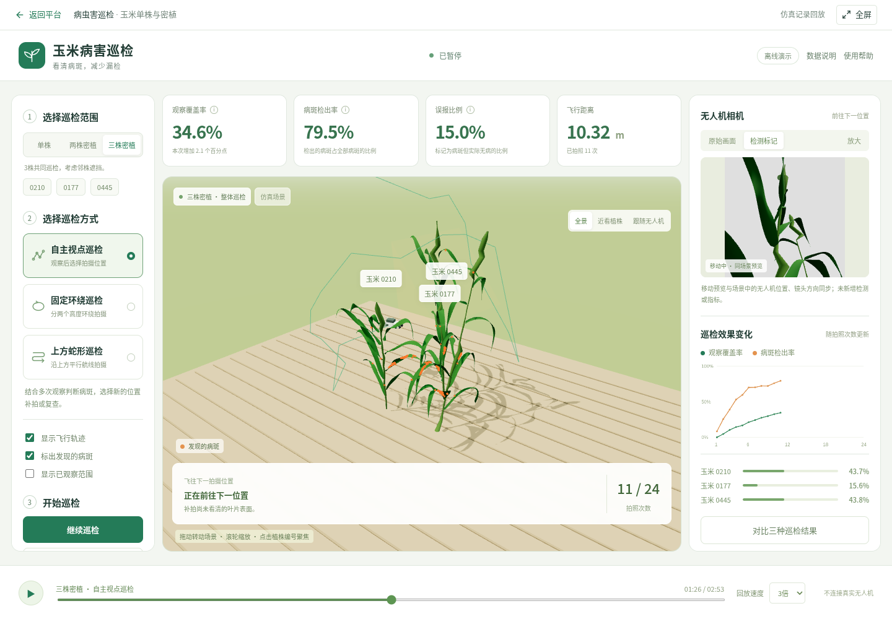

<div align="center">

# 🚁 UAV Inspection Platform

**低空智能巡检与决策平台** — 一个 FastAPI + Vue 3 的无人机巡检演示系统：
单容器部署、12 个业务模块、WebSocket 实时推理流、内置素材上传中心。

[](https://www.python.org)
[](https://fastapi.tiangolo.com)
[](https://vuejs.org)
[](https://vitejs.dev)
[](deploy/)
[](#license)

*首页 · 三大业务分组，12 个业务模块（截图为加入粉黛花漫游前的界面）*


</div>

---

## ✨ 功能模块

| 分组 | 模块 | 能力 |
|---|---|---|
| 🏗️ 基础设施巡检 | 通信基站巡检 | 基站、天线识别与视频检测；SRT 可选，用于定位与飞行数据 |
| | 杆路线路巡检 | 电杆、线缆识别与视频逐帧检测 |
| | 建筑屋顶巡检 | 离线缺陷结果、轨迹与报告回放 |
| | 建筑外墙巡检 | 外墙脱落检测、播放标框、复核与维修工单、历史任务 |
| 🌱 农林植保业务 | 病虫害巡检（演示） | 玉米单株与密植、三种巡检回放、病斑指标与结果对比、JSON 导出 |
| | 乔木修剪检测 | 修剪识别、状态分析 |
| | 树高测量 / 绿化面积 | 基于预处理点云和测量结果的查看与分析 |
| 🌹 数字园区治理 | 数字玫瑰园 | 地块态势、数字档案（演示数据） |
| | 粉黛花三维漫游 | 3D Gaussian Splatting 场景、第一人称与触控漫游 |
| | 玫瑰花产量估计 | 花朵、花苞及采摘状态识别与计数，产量估计展示 |
| | 热力客流监测 | 人员分布、聚集预警（实时推理流） |
| 📦 素材管理 | **素材上传中心** | 按模块上传、权重自动命名与试运行、视频转码、分片续传、防覆盖开关 |

### 设计特点

- **单进程同源架构** — FastAPI 一个进程同时服务 REST API、WebSocket、静态前端与媒体文件；账号、外墙任务及工单保存在 SQLite，素材与权重保存在数据目录，无需单独部署数据库服务
- **按模块检查推理条件** — 默认 Docker 镜像包含 CPU 推理依赖；源码仅安装 `requirements.txt` 时提供基础服务。缺少模型或运行环境时页面提示缺项，相关检测接口返回错误；外墙 ONNX 可使用基础环境中的 OpenCV 在 CPU 运行
- **子路径友好** — 前端构建期 `VITE_BASE` + 后端运行时 `UAV_URL_PREFIX` 双参数化，同一份代码支持根路径与 `/xxx/` 子路径两种挂载方式
- **素材即数据** — 演示素材（视频/模型/测量结果）不进镜像，经上传中心或 API 灌入持久化卷

## 🖼️ 界面一览

| 素材上传中心 | 通信基站巡检 |
|---|---|
|  |  |

*左：`/assets` 上传中心——分类下拉自带目标目录提示；右：巡检工作台——无人机状态面板 + 视频检测区*

### 📱 移动端

响应式布局（PR [#5](https://github.com/thiswind/uav-inspection/pull/5)，感谢 [@rg-ut](https://github.com/rg-ut)），手机浏览器 / 窄窗口直接可用：

| 无人机巡检首页 | 素材上传 | 云锡统一门户 |
|---|---|---|
|  |  |  |

*390×844（iPhone 12 Pro 视口）实拍；两套演示系统均完成移动端适配*

## 🏗️ 架构


```
uav-inspection/
├── app/
│   ├── uav-inspection-backend/     # FastAPI（每模块一个 app 包 + assetsapp 素材中心）
│   │   ├── heatmapapp/             # 主入口 main.py：路由聚合 + SPA 托管 + WebSocket
│   │   ├── assetsapp/              # 二阶段素材上传（分类白名单/防穿越/防覆盖）
│   │   ├── telecomapp/ wallapp/ ...# 各巡检模块（检测接口 + 可选推理）
│   │   ├── uav_url_prefix.py       # UAV_URL_PREFIX 响应体 URL 前缀化（子路径支持）
│   │   ├── optional_inference.py   # AI 可选依赖降级层（无 torch 时 503 提示）
│   │   ├── deployment_paths.py     # 数据目录/前端 dist 路径推导
│   │   └── tests/                  # 官方部署测试 + 素材上传测试
│   └── uav-inspection-ui/          # Vue 3 + Vite + Tailwind + Pinia + ECharts
│       └── src/utils/webroot.ts    # VITE_BASE 前端路径工具（子路径支持）
└── deploy/                         # 服务器部署（Docker Compose 单容器）
    ├── compose.yml                 # 端口/前缀/数据卷均可环境变量覆盖
    ├── docker/Dockerfile           # 多阶段：node 构建 → python 运行时
    ├── nginx/uav-locations.conf    # 子路径反代片段（含 WS upgrade / 大文件上传）
    ├── scripts/build_and_push.sh   # 镜像构建推送（registry 地址可覆盖）
    └── .env.example
```

## 🚀 快速开始

### 方式一：开发者笔记本（venv，适合开发调试）

> 适合 Windows / macOS / Linux 本地调试。锁定依赖需要 Python 3.12–3.13（推荐 3.12），以及 Node 22.12+ 或 24 LTS。视频转码另需安装 ffmpeg，并确保命令在 PATH 中可用。

```bash
# 1) 后端（隔离 venv，不动系统 Python）
cd app/uav-inspection-backend
python -m venv .venv && source .venv/bin/activate      # Windows: .venv\Scripts\activate
pip install -r requirements.txt
# 仅浏览页面、上传文件及使用外墙 ONNX 时，基础依赖即可。
# 如需使用 PT 权重，在当前 venv 中继续安装：
# python -m pip install torch==2.9.1 torchvision==0.24.1 --index-url https://download.pytorch.org/whl/cpu
# python -m pip install -r requirements-inference.txt
python -m uvicorn heatmapapp.main:app --port 8002      # API 文档: http://localhost:8002/docs

# 2) 前端（另一终端，从仓库根目录执行；开发时用 Vite 热更）
cd app/uav-inspection-ui
npm install
npm run dev                                            # http://localhost:5173
```

> 首次以纯后端方式访问 `http://localhost:8002` 会提示缺少前端构建产物——开发期用 Vite 的 5173 端口即可；或先 `npm run build` 再刷新 8002。
> Windows 下另有官方 `setup.bat` / `start-all-local.bat` 一键脚本（在 `app/` 下）。

### 方式二：服务器（Docker Compose，适合长期演示）

```bash
# 以下命令均在仓库根目录执行；已有可用镜像时：
test -f deploy/.env || cp deploy/.env.example deploy/.env
# 按需编辑 deploy/.env，设置可访问的 UAV_IMAGE、端口和子路径
docker compose --env-file deploy/.env -f deploy/compose.yml up -d
curl http://127.0.0.1:18020/api/health                 # → {"status":"ok"}

# 需要自行构建并推送时（需要 Docker 和可用的 registry）：
VITE_BASE=/uav/ bash deploy/scripts/build_and_push.sh  # UAV_REGISTRY 可覆盖 registry 地址
# 确保 deploy/.env 中的 UAV_IMAGE 与刚推送的镜像一致，再更新容器
docker compose --env-file deploy/.env -f deploy/compose.yml pull
docker compose --env-file deploy/.env -f deploy/compose.yml up -d --force-recreate
```

### 挂到 nginx 子路径（可选）

反向代理片段见 [deploy/nginx/uav-locations.conf](deploy/nginx/uav-locations.conf)：剥前缀转发 + WebSocket upgrade + 4G 上传限制。要点：

```nginx
location ^~ /uav/ {
    proxy_pass http://127.0.0.1:18020/;        # 尾斜杠 = 剥掉 /uav/ 前缀
    proxy_http_version 1.1;
    proxy_set_header Upgrade $http_upgrade;     # WebSocket（热力图实时流 / 病虫害 Agent）
    proxy_set_header Connection $connection_upgrade;
    client_max_body_size 4g;                    # 演示视频上传
    proxy_buffering off;                        # multipart 推理流
}
```

三处前缀保持一致即可：**nginx 片段**、**前端构建参数 `VITE_BASE=/uav/`**、**后端环境变量 `UAV_URL_PREFIX=/uav`**。全部置空则回到根路径部署（上游原始行为）。

## 📦 素材上传中心（二阶段）

演示素材（巡检视频、SRT 字幕、模型权重、测量结果）**不进镜像**，两种灌入方式：

1. **页面**：部署后访问 `/assets`（首页「素材管理」分组入口），分类下拉自带目标目录提示，默认重名跳过不覆盖
2. **API**：`POST /api/v1/assets/upload`（multipart：`category` + 可选 `subdir` + `files[]`）；`GET /api/v1/assets/categories` 拉分类清单，`GET /api/v1/assets/files?category=...` 看目录内容

安全设计：21 分类**白名单**（未知分类 422）、子目录逐段校验拒路径穿越、文件名 basename + 控制字符清洗、`overwrite=true` 才允许覆盖已有文件。
专用业务模型分类限定文件名和空子目录，避免模型上传后落入检测器不读取的位置。

### 其他模块打开后无法检测或任务为空

新构建的默认镜像包含 CPU 推理依赖（`UAV_INSTALL_INFERENCE=1`）；设置为 `0` 可构建轻量回放版本。
已有基础镜像需要重新构建并更新容器，单独上传权重不会安装服务器依赖。
源码开发环境按上面的 venv 命令安装推理依赖并重启后端。也可从仓库根目录使用独立部署环境：

```bash
python app/deploy.py install --inference
python app/deploy.py start
```

该方式使用 `app/.venv-deploy`，安装与启动需配套使用；不会给另一套正在运行的 venv 自动添加依赖。
页面会按模块显示缺项，并跳转到对应上传分类。上传任意文件名的可信 `.pt` 权重时，素材中心会保存为模块要求的名称。
上传后点击“检查并试运行模型”，成功后再进入模块选择视频并开始检测。替换权重后会自动重新加载；树高与绿化模块还需点云及测量结果。
外墙新版工作台的视频需通过“上传外墙任务”建立账号绑定任务；旧 `wall-media` 目录中的文件仅供历史工具使用。
新版工作台支持 ONNX 或已安装的 PT 权重，可勾选“边播放边检测”预览检测框，或点击“开始检测”后台生成分析记录。
模型上传权限通过 `UAV_WALL_ADMINS` 指定；没有权限时页面显示部署授权提示。
各模块任务上传支持将可解码的视频转换为浏览器兼容 MP4，服务器需安装 `ffmpeg`；抽帧推理速度取决于模型与服务器配置。
通信基站和玫瑰视频检测不再强制上传 SRT；没有字幕时可正常推理，定位与飞行数据暂不可用。
屋顶现有功能是离线结果回放；病虫害使用玉米单株与密植离线包的交互回放，数字玫瑰园展示示例档案。玉米模块集成与部署说明见 [app/docs/maize-inspection.md](app/docs/maize-inspection.md)。


完整目录、安装命令、模块边界与验收步骤见 [业务模块恢复说明](app/docs/module-recovery.md)。

### 上传后开始演示

1. 登录平台，进入素材上传中心，选择模块对应的权重分类并上传可信 `.pt`；文件名由页面自动处理。
2. 点击“检查并试运行模型”。确认成功后，再进入对应模块上传或选择巡检视频；需要定位时添加对应字幕。
3. 外墙新版工作台使用“上传外墙任务”创建账号绑定任务。可由授权账号添加单类别 YOLO ONNX，或使用素材中心已安装的 PT 权重。
4. 在外墙工作台勾选“边播放边检测”并播放视频可预览检测框；“开始检测”生成完整分析记录，之后可复核、派单与导出。

外墙模型上传账号由 `UAV_WALL_ADMINS` 指定。Docker 部署在 `deploy/.env` 中配置已注册的管理员账号，修改后重新创建容器使配置生效；本地启动则设置同名环境变量。完整外墙流程见 [外墙巡检说明](app/docs/wall-inspection.md)。
逐帧预览按服务器处理能力抽帧，不保证与视频帧率一致。测试样片与测试模型仅用于验证链路；业务效果需使用对应训练权重和现场视频验收。

## 乔木高度与绿化面积测量数据

仓库随附 5 个地块的运行数据：网页点云、917 棵候选乔木的高度结果、
绿化面积结果、预览图及两个轻量模型，共约 66.17 MiB，位于 `data/vegetation/`。
从仓库根目录执行以下命令，即可离线安装到程序实际读取的数据目录：

```bash
python app/scripts/install_vegetation_data.py
```

默认安装到仓库根目录的 `02-data/`；已有相同文件自动跳过，不同内容默认拒绝覆盖。
外置数据目录使用 `--data-dir`，与服务的 `UAV_DATA_DIR` 保持一致。
安装后刷新 `/height` 和 `/area` 页面。
服务器 Docker 数据卷的安装命令、SHA-256 校验和数据范围见
[测量数据安装说明](app/docs/vegetation-data.md)。

## 粉黛花三维漫游

首页“数字园区治理”中的“粉黛花三维漫游”进入 `/fendai-flower`。
浏览器通过 Three.js + GaussianSplats3D 加载已有 KSplat 场景，支持 WASD、鼠标转向、
升降、加速、重置、全屏与手机触控。基础后端即可提供模型，无需安装推理依赖、CUDA 或 Unity。

模型独立发布在 [粉黛场景 Release](https://github.com/DavidSMET/uav-inspection/releases/tag/fendai-scene-v1)，
约 98.74 MB，1,370,364 个高斯点，不进入代码仓库与 Docker 镜像。
从仓库根目录安装到源码默认数据位置：

```bash
python app/scripts/install_fendai_scene.py
```

脚本下载后检查大小与 SHA-256，再安装到
`app/uav-inspection-backend/fendaidata/scenes/fendai-flower.ksplat`。
使用外置数据时加 `--data-dir`，与服务的 `UAV_DATA_DIR` 保持一致。
也可下载模型后在素材上传中心选择“粉黛花三维场景（.ksplat）”，子目录留空并上传原文件名。
缺模型时页面显示安装指引；上传后重新进入即可。

接口、Docker 数据卷安装、子路径配置、文件校验和功能边界见
[粉黛花部署说明](app/docs/fendai-flower.md)。


### 大文件分片上传（断点续传）

1GB+ 的巡检视频走直传极易超时，上传中心内置**分片协议**，前端自动启用：

```
POST /api/v1/assets/upload/init      # 声明文件 → 拿 uploadId / chunkSize / totalChunks
                                      #（未开启覆盖时，同名同大小跳过；不校验内容相同）
GET  /api/v1/assets/upload/status    # 已收分片列表 → 断点续传的依据
POST /api/v1/assets/upload/chunk     # 逐片上传（幂等，重试安全）
POST /api/v1/assets/upload/complete  # 分片齐全+总大小校验后原子合并落盘
```

- 分片大小默认 **8MB**（`UAV_CHUNK_SIZE` 环境变量可调），单请求体积小、单片失败只重传一片
- 页面支持**进度条 / 暂停继续 / 失败重试**；上传中刷新页面，进度仍保留（uploadId 持久化，重选文件自动跳过已传分片）
- 服务端原子合并（临时名 + rename），不产生半文件；废弃分片 7 天自动清理
- nginx 侧无需为总文件大小放宽 `client_max_body_size`——只需覆盖单片

## ✅ 测试

```bash
cd app/uav-inspection-backend

# 官方部署测试（路径推导/数据目录/降级行为）
UAV_DATA_DIR=$(mktemp -d) python -m unittest discover -s tests -p test_optional_deployment.py

# 素材上传中心（白名单/穿越拒绝/防覆盖/清单）
UAV_DATA_DIR=$(mktemp -d) python -m unittest discover -s tests -p test_uav_assets_upload.py

# 分片上传（全流程/断点续传/秒传/竞态去重/参数校验/废弃清理）
UAV_DATA_DIR=$(mktemp -d) python -m unittest discover -s tests -p test_uav_assets_chunked.py

# 实际 ONNX 推理、视频转码与无字幕任务（需 ffmpeg / ffprobe）
python -m unittest discover -s tests -p test_upload_inference_pipeline.py

# 六模块 PT 试运行（需已安装推理依赖；生成未训练权重，仅验证链路）
UAV_TEST_PT=1 python -m unittest discover -s tests -p test_pt_runtime.py

# 前端类型检查 + 构建
cd ../uav-inspection-ui && npm run build
```

> 后端各套测试请**按文件分别启动进程**：它们会切换 `UAV_DATA_DIR` 并 import 应用，`deployment_paths` 的模块级路径会被先到者冻结，混跑会互相污染（详见测试文件头注释）。

## 📚 更多文档

| 文档 | 内容 |
|---|---|
| [app/README.md](app/README.md) | 上游交付说明（Windows 一键脚本、模块细节） |
| [app/docs/deployment-verification.md](app/docs/deployment-verification.md) | 部署验收单 |
| [app/docs/api.md](app/docs/api.md) | API 说明（另可看运行时的 `/docs` OpenAPI） |
| [docs/architecture.excalidraw](docs/architecture.excalidraw) | 架构图源文件（可用 Excalidraw 编辑） |

## License

MIT

## 平台账号

首页支持登录、注册和退出。默认演示账号为 **admin**，密码为 **admin123**，也会显示在登录区域下方。
注册后自动登录，刷新保留会话；未登录进入模块时会先提示登录，再返回所选模块。
账号使用服务端数据库保存，详见 [账号说明](app/docs/accounts.md)。
